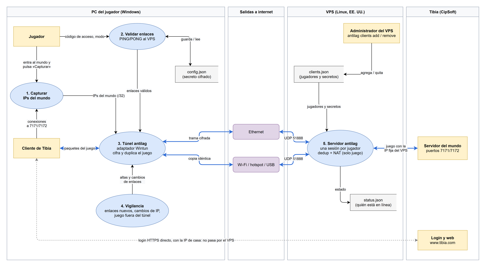
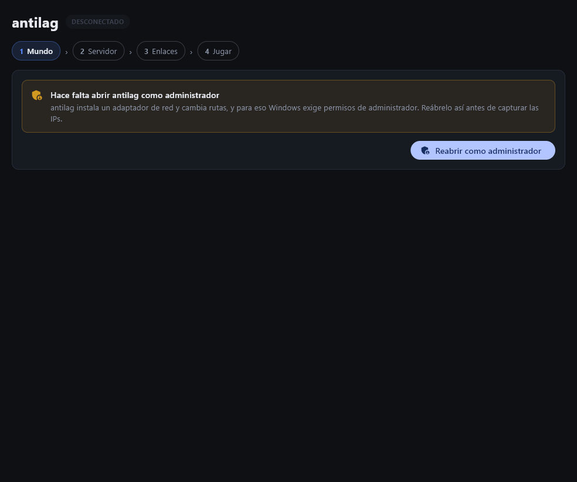
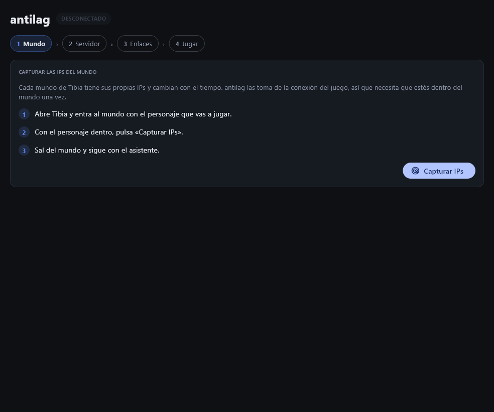
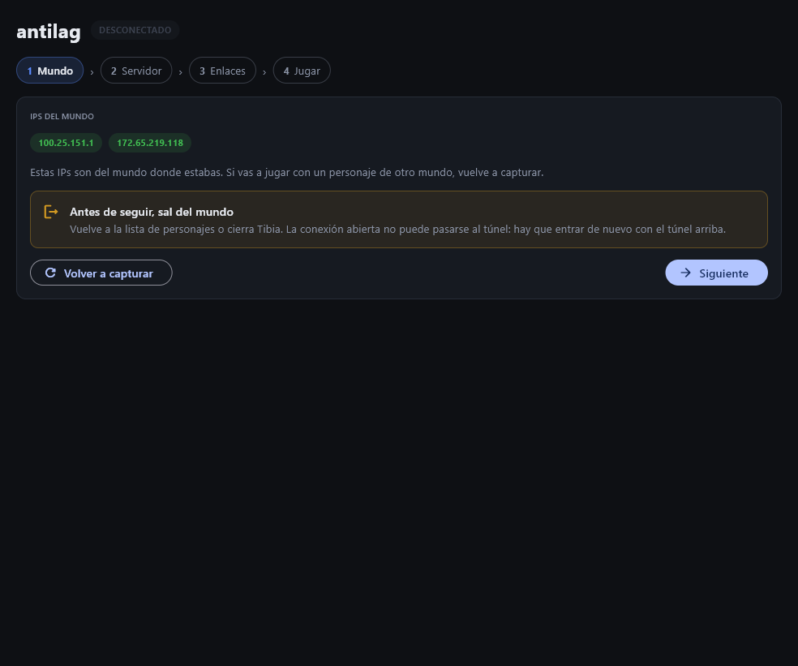
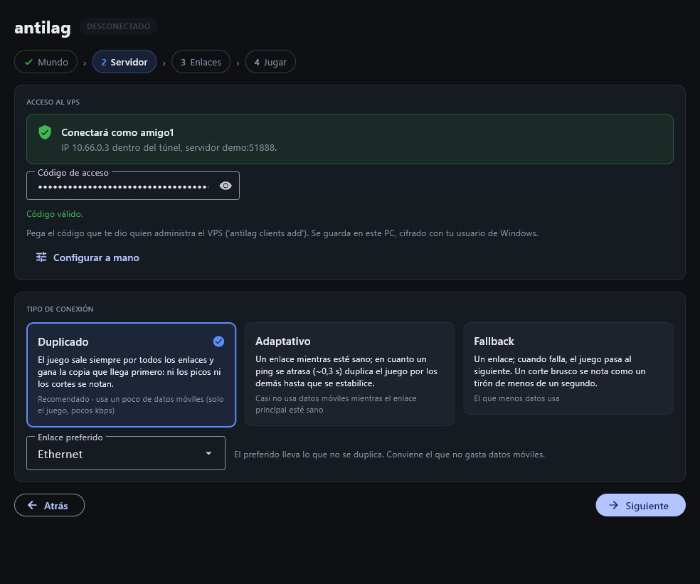
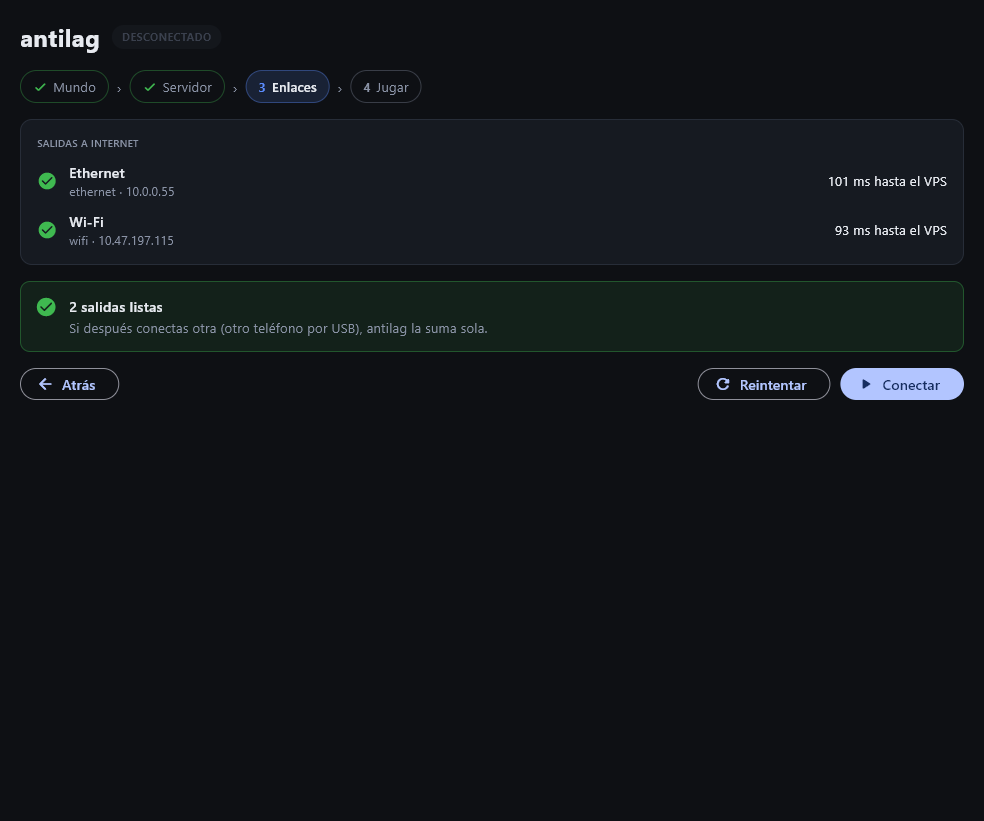
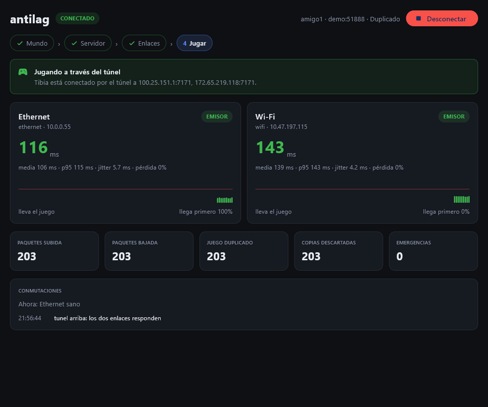
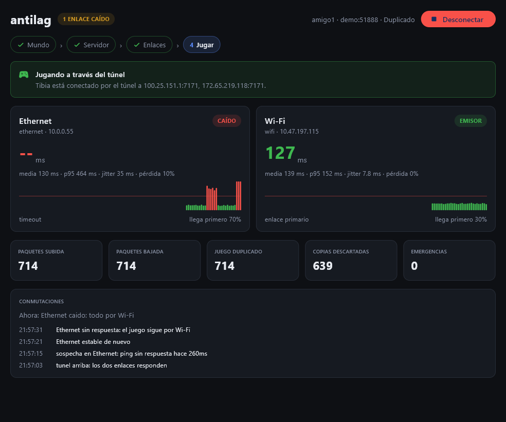

# antilag

**Play Tibia over several internet connections at once, with no lag from latency spikes and without losing your session when one of them drops.**

> English · [Versión en español](README.es.md)

---

## Motivation

### Why it was built

In Venezuela, internet connections are unstable. Over a fiber or DSL line, the ping to Tibia's servers (hosted on AWS in the US) is around 100 ms, which is perfectly playable. The problem is the **500 ms spikes** and the **multi-second outages**: in game, that means freezing in front of a monster, and often dying and losing levels.

The obvious fix is a second connection (Wi-Fi, a phone hotspot) and switching to it when the first one fails. But **Tibia does not allow that**. Switching connections changes your public IP, and the server ends the session with *"Game session is locked to a different IP"*, which in practice is the same as the outage you were trying to avoid.

### What it does

antilag creates a **tunnel between your PC and your own VPS** in the US, close to the game server:

- The game always reaches the internet **with the VPS's fixed IP**, no matter which physical connection each packet travels over. So you can switch links, or use several at once, without Tibia noticing.
- Every game packet is **sent in duplicate over all your connections** (cable, Wi-Fi, a phone over USB…). The VPS keeps the first copy that arrives and drops the rest. The effective latency is **that of the fastest link at every instant**: a spike or an outage on one of them goes unnoticed.
- **Only game traffic** goes through the VPS. Tibia's login and website go out directly with your home IP, because CipSoft rejects those services from datacenter IPs.



*Data flow diagram (labels in Spanish). In blue, the path of the game packets. The editable source is [`docs/antilag-dfd.drawio`](docs/antilag-dfd.drawio).*

| # | Process | What it does |
|---|---|---|
| 1 | **Capture the world's IPs** | With the character inside the world, it reads the client's connections to ports 7171/7172 and gets that world's server IPs. Only those IPs enter the tunnel. |
| 2 | **Validate links** | Sends a PING to the VPS over every internet connection. At least two are required: with a single one there is nowhere to switch to. |
| 3 | **antilag tunnel** | Creates a virtual network adapter (Wintun). Encrypts each game packet once and sends it over every link. |
| 4 | **Watchers** | Detects new links (another phone over USB) or links whose IP changed (a hotspot reconnecting) and adds them live. It also warns if Tibia connected outside the tunnel. |
| 5 | **antilag server** | On the VPS: one isolated session per player. Keeps the first copy of each packet, sends it out through NAT with the fixed IP, and replicates the reply over all of the player's links. |

### Why it works this way

- **Duplicate instead of detect-and-switch.** Any system that waits to detect a problem before switching links is too late: the spike has already happened. Duplicating protects **during** the spike. Since Tibia's traffic is only a few kbps, duplicating it costs almost no data.
- **A VPS close to the world.** With the VPS in the same region as the Tibia server (us-east), the detour adds almost no latency: 94–100 ms were measured to the VPS versus 104 ms directly to the world.
- **Custom protocol over UDP.** WireGuard would solve the IP change, but each peer uses a single path at a time: it can switch, but not duplicate. antilag uses ChaCha20-Poly1305 with per-session and per-player keys, and an anti-replay window that also drops the duplicate copies.

---

## Results

- **Neither spikes nor outages are noticeable.** In the end-to-end tests, a 400 ms spike and then a full outage were simulated on one of the links with `tc netem`. In Duplicate mode, the game never went above **2 ms** of latency and lost **no** messages.
- **Unplugging the cable mid-game does not drop the session.** Tested with real Tibia: you unplug the cable, and the game carries on over Wi-Fi with no logout and no freeze.
- **Hot-plugged links.** A third link that appears, or a Wi-Fi that comes back with a different IP, joins on its own while the game is running, without losing messages.
- **Several players on the same VPS**, isolated from each other: each one with their own secret and their own tunnel IP. One player losing their cable or restarting does not affect the others.
- **No CipSoft blocks.** The login goes out with the home IP and the game with the VPS's, so the 403 and the false *"down for maintenance"* do not show up.
- **Real-world use**: several days of play with excellent results.
- **Quality**: over 220 automated tests, including end-to-end tests with real tunnels, links and failures inside Linux *network namespaces*.

| Lab test (full outage of one link) | Worst game latency |
|---|---|
| Duplicate mode | ~2 ms (the outage goes unnoticed) |
| Adaptive mode | ~180 ms |
| Fallback mode | ~640 ms |
| Classic switching, without fast detection (the first version) | 3,155 ms |

---

## Technology

- **Python 3.10+**, with no binary dependencies other than `cryptography`.
- **Cryptography**: ChaCha20-Poly1305 (AEAD) and HKDF-SHA256, with one key per session and per player.
- **Windows**: [**Wintun**](https://www.wintun.net/) virtual adapter (WireGuard's driver) via `ctypes`, routes through `netsh`, secrets encrypted with **DPAPI**.
- **Linux (VPS)**: **TUN** interface, `asyncio` server with `IP_PKTINFO` (works with reserved IPs), NAT with **iptables** and a **systemd** service.
- **UI**: [**Flet**](https://flet.dev/) 1.0 (Flutter from Python).
- **Packaging**: `flet pack` (**PyInstaller**): a single `.exe` that asks for administrator rights when opened.
- **Testing**: `unittest`, Linux *network namespaces* and `tc netem` to simulate spikes, outages and IP changes.
- **Diagrams**: draw.io.

---

## Setup

There are two parts: the **server on a VPS** (once) and the **panel on every PC** that will play.

### 1. Server (Linux VPS)

**Requirements:**
- A VPS running Ubuntu 22.04/24.04, in your world's server region. For worlds on AWS us-east: Ohio or Virginia on AWS, or New York on DigitalOcean. The smallest plan is more than enough.
- **UDP port 51888** open in the provider's firewall (security group on AWS, Cloud Firewall on DigitalOcean).

**Installation:**

```bash
git clone https://github.com/mitdua/antilag.git
cd antilag
sudo bash deploy/setup-vps.sh
```

The script can be run again to update, and it does all of this:
- installs antilag in `/opt/antilag`;
- sets up forwarding, NAT and MSS clamping, and makes them persistent;
- creates the `antilag` service;
- creates the first player, `principal`, and **prints their access code**.

**Players:**

```bash
sudo antilag clients add friend1       # creates a player and prints their access code
sudo antilag clients list              # who exists and who is online
sudo antilag clients code friend1      # shows their code again
sudo antilag clients remove friend1    # revokes them immediately
```

The **access code** (`antilag1:…`) contains the server, the player and their secret. Treat it like a password. If you use a reserved or floating IP, set it with `sudo antilag clients endpoint IP:51888` before handing out codes.

### 2. Player's PC (Windows)

#### Option A: executable (recommended)

Download `antilag.exe` from the repository's **[Releases](https://github.com/mitdua/antilag/releases/latest)** section and open it. Nothing needs to be installed.

> GitHub discourages storing executables inside the repository, but it does allow attaching them to a **Release** (up to 2 GB per file). The direct link to the latest version is
> `https://github.com/mitdua/antilag/releases/latest/download/antilag.exe`.

- Windows asks for **administrator rights** when you open it: they are needed to create the network adapter.
- Since the executable is not digitally signed, the first time *SmartScreen* may show "Windows protected your PC". Click **More info → Run anyway**.

**Building the `.exe` yourself:**

```powershell
git clone https://github.com/mitdua/antilag.git
cd antilag
powershell -ExecutionPolicy Bypass -File scripts\build_exe.ps1
```

The script installs what it needs (Flet, PyInstaller, cryptography), downloads `wintun.dll` checking its hash, and leaves **`dist\antilag.exe`** (~65 MB). With `-SinAdmin` it builds a test version that does not ask for administrator rights.

**Publishing a version:** the `.exe` in the Releases is built automatically by GitHub Actions ([`.github/workflows/release.yml`](.github/workflows/release.yml)). Pushing a version tag makes the workflow run the tests on Linux and Windows, build the `.exe` with the same script, and attach it to a new Release:

```bash
git tag v1.0.0
git push origin v1.0.0
```

It can also be run by hand from the **Actions** tab (*Run workflow*): it builds the `.exe` and keeps it as an artifact, without publishing a Release.

#### Option B: from source, without building the `.exe`

Requires **Python 3.10+**. In a terminal **running as administrator**:

```powershell
git clone https://github.com/mitdua/antilag.git
cd antilag
python -m pip install --user cryptography "flet>=1.0"
python -m antilag fetch-wintun          # downloads wintun.dll and checks its hash
python -m antilag panel                 # opens the panel
python -m antilag panel --demo          # panel with simulated links, no VPS or administrator needed
```

**Tests:**

```bash
python -m unittest discover -s tests -t .
# On Linux, including the end-to-end ones (about 2 minutes):
ANTILAG_E2E=1 python -m unittest discover -s tests -t .
```

---

## Walkthrough

The panel is a four-step wizard. Its interface is currently in Spanish (multi-language support is planned); the button and label names below are quoted as they appear on screen, with a translation. The screenshots come from demo mode (`--demo`), with simulated links.

### Before you start: administrator rights



If the panel is opened without administrator rights, it says so **in the first step**, before capturing anything. With the **Reabrir como administrador** (*Reopen as administrator*) button, Windows shows the permissions dialog and the panel opens again with privileges. The executable asks for these rights by itself.

### Step 1: World (*Mundo*)



Each Tibia world has its own IPs, and they change over time. For antilag to know which traffic to carry through the tunnel:

1. Open Tibia and **enter the world** with the character you are going to play.
2. Click **Capturar IPs** (*Capture IPs*).



3. **Leave the world**, either to the character list or by closing Tibia, and click **Siguiente** (*Next*). An already open connection cannot be moved into the tunnel; if Tibia is still inside the world, the panel does not let you continue.

The IPs are kept in memory only: they are forgotten when the panel closes, because they change from world to world.

### Step 2: Server (*Servidor*)



- **Código de acceso** (*Access code*): paste the one the VPS administrator gave you. The panel shows which player and IP you will connect as. It is stored on your PC, encrypted with your Windows user.
- **Tipo de conexión** (*Connection type*):
  - **Duplicado** (*Duplicate*, recommended): the game always goes out over every link; neither spikes nor outages are noticeable.
  - **Adaptativo** (*Adaptive*): a single link while it is healthy; if a ping falls behind (~0.3 s), it duplicates as an emergency.
  - **Fallback**: a single link; if it fails, it moves to the next one. A sudden outage is felt as a brief stutter.
- **Enlace preferido** (*Preferred link*): the one that carries what is not duplicated. Pick the one that does not use mobile data.

### Step 3: Links (*Enlaces*)



The panel sends a PING to the VPS over every internet connection and shows how long each one takes. A valid reply confirms at once that the link reaches the internet, that the VPS is up and that the code is correct.

- **At least two** connections must respond; otherwise the panel explains why and offers **Reintentar** (*Retry*).
- With two or more, **Conectar** (*Connect*) brings the tunnel up.

### Step 4: Play (*Jugar*)



With the tunnel up, **enter the world** as usual:

- **Top notice**: confirms "Jugando a través del túnel" (*Playing through the tunnel*) when it detects the game going through the tunnel. It turns red if Tibia connected outside of it, for example because you entered a different world.
- **One card per link**:
  - the live ping and its state (`EMISOR` *sender*, `EN ESPERA` *standby*, `SOSPECHA` *suspect*, `CAÍDO` *down*);
  - a chart of the last two minutes, with a fixed 0–600 ms scale and a line at 300 ms, the point beyond which Tibia becomes unplayable;
  - how often that link delivers first.
- **Counters**: packets sent and received, how much of the game was duplicated and how many copies were dropped.
- **Conmutaciones** (*Switches*): the history of what the panel decided and why.

This is what a cable outage looks like while the game is running:



The cable shows as `CAÍDO` (*down*), with the outage in red on its chart and the earlier spike also visible. The header warns "1 ENLACE CAÍDO" (*1 link down*), and the Wi-Fi keeps carrying the game: **for the player, nothing happened**.

**Desconectar** (*Disconnect*), or closing the window, brings the tunnel down and leaves Windows' network as it was.

---

## Disclaimer

- antilag is a **personal, non-profit project**, built to solve a real connectivity problem. It is not sold or offered as a service.
- It is **not affiliated with CipSoft GmbH** or Tibia. Tibia is a registered trademark of CipSoft GmbH.
- antilag **does not modify, read or automate** anything in the game: it only carries the packets, encrypted, over several connections and drops the duplicate copies. It is the same category as the commercial lag-reduction tools used in many games. Even so, **each user is responsible** for using it in accordance with the rules and terms of service of Tibia and of their internet and VPS providers.
- Whoever runs the VPS is responsible for its cost, its security, and for who they hand access codes to.
- It is provided **as is, without warranty** of any kind. Use it at your own risk.
